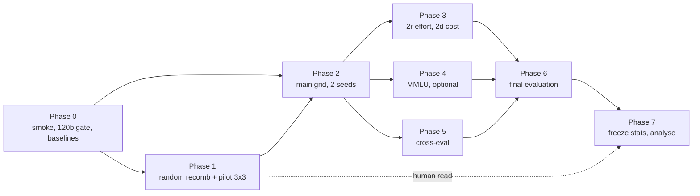

# Experimental plan, ordered by question priority

Priority: **Q7 → Q8 → Q9 → Q1 → Q2 → Q3 → Q4 → Q5 → Q6**

Questions themselves are in [questions.md](questions.md). This document is the run
order, and the exact data points each question is answered from.

## Priority is not run order

Your ordering is an **interest** ordering: what you most want to know, what leads the
write-up, and what survives a budget cut. It is not a run order. Three orderings exist
here and only one of them is yours to choose freely:

| Ordering | Set by | Value |
|----------|--------|-------|
| Interest | you | Q7 → Q8 → Q9 → Q1 → Q2 → Q3 → Q4 → Q5 → Q6 |
| Run | data dependencies, with interest as tie-break | the phases below |
| Reporting | interest | your order, unchanged |

The good news first: the two orderings largely agree. Q7, Q8 and Q9 are *archive*
questions — any search produces their evidence — whereas Q1 through Q5 need specific
arms. So a dependency-correct schedule naturally delivers your top three priorities
early. Only the details needed fixing.

### Flaws in running the interest order literally

The previous version of this document scheduled phases in interest order. Nine problems
with that, in descending severity:

1. **Q1 was scheduled before Stage 2r, which Q1 depends on.** Q1's controlled evidence
   is the reasoning-effort contrast — the only place model identity is held fixed. Phase
   C (Q1) preceded Phase D (2r). Circular.
2. **Final re-evaluation preceded the last searches.** Agents from 2d and 2r would never
   be re-evaluated, or would need a second inconsistent pass.
3. **Q8 was assigned to a single-seed phase.** Stage 1 runs one seed per cell. "Small
   designers design differently" cannot be separated from run-to-run variance at n=1.
   Q8's real evidence is the two-seed Stage 2, not the pilot.
4. **Random recombination was too late.** Q7 asks what designs look like — but
   *surprising relative to what?* Relative to the seed archive **and** to what blind
   splicing produces. Without that calibration the first read has no baseline. It is
   also the cheapest cell in the campaign, so there is no reason to defer it.
5. **Pooled z-scoring was treated as readable early.** `PooledStats` is fit once across
   the whole campaign; every novelty and structural distance shifts as designs arrive.
   Any number read before the freeze is provisional.
6. **gpt-oss-120b feasibility was not a gate.** The top meta rung is still unresolved.
   Q8 is priority 2 and needs three tiers; if the 120b cannot co-reside with a worker,
   the ladder loses its top rung and everything downstream is built on sand.
7. **"Q1, Q2 and Q6 need no dedicated runs" was overstated.** True for Q6 only. Q1 needs
   the Stage 0.5 baselines and Q2 needs the final re-evaluation. Neither is a *search*,
   but both are compute.
8. **Human reading was serialised against compute.** Reading designs and running
   searches do not contend for the same resource. The Q7 read should overlap the next
   phase's queue time.
9. **Contamination scan came after the human read.** Reading designs before knowing
   which are memorised published techniques biases the reader.

### Dependency graph



The only hard chains are: baselines before any informed search, searches before the
agents they produce can be transferred or re-evaluated, and everything before the
statistics are frozen.

---

## Run order

| Phase | Produces evidence for | Stages | Cells | Designs | GPUs |
|-------|----------------------|--------|-------|---------|------|
| **0** | feasibility, Q1 anchors | `0` smoke, 120b probe, `0.5` | 1 + 8 | — | 1–3 |
| **1** | Q7 provisional, Q6, design-space baseline | `2c` random, `1` pilot | 2 + 9 | ~170 | 1–4 |
| **2** | **Q7, Q8, Q9** | `2` main, `2c` refs, `1b` | 10 + 4 + 4 | ~320 | 2–4 |
| **3** | Q3, Q4, unblocks Q1 | `2r`, `2d` | 4 + 6 | ~200 | 2–4 |
| **4** | Q9 second domain *(optional)* | `3` MMLU | 4 | ~80 | 4 |
| **5** | Q5 | cross-eval | 3 tasks | 0 new | 2 |
| **6** | **Q1, Q2** | final evaluation, no search | — | 0 new | 1–2 |
| **7** | all — freeze and analyse | none | — | — | CPU |

Cumulative designs: ~170 after Phase 1, ~490 after Phase 2, ~690 after Phase 3, ~770
with the optional MMLU phase.

### Phase 0 — feasibility and anchors

Blocks everything, so it runs first regardless of interest.

- `s0_smoke` — pipeline end to end.
- **`sanity/04_meta120_probe.slurm`** — does gpt-oss-120b serve at tp=2 beside a worker.
  This is a gate, not a curiosity: a negative result swaps the top meta rung to
  `nemotron-3-super-120b` and must be settled before Phase 1 commits to a ladder.
- Stage 0.5, eight cells: bare model and solo CoT per worker, plus gpt-oss-20b at low
  and high effort. No search, no meta server, `valid_size: 128`, `n_repreat: 5`.

```bash
sbatch --array=0-7 experiments/slurm/stage05_baselines.slurm
```

Stage 0.5 is a hard dependency, not an anchor for a low-priority question: the measured
CoT accuracy is what the **informed** meta agent is told about its worker. `_common.sh`
now refuses to start any informed search when the baseline is missing, because the
previous behaviour was to omit the number and run anyway — which would have left Stage
1b's informed/blind contrast measuring nothing while still producing healthy-looking
archives. Set `ALLOW_MISSING_BASELINE=1` to override deliberately.

### Phase 1 — design-space calibration and pilot

Two things, submittable together because they do not contend:

```bash
sbatch --export=ALL,STAGE=2 --array=10,11 experiments/slurm/stage2_main.slurm  # random recombination
sbatch --array=0-8 experiments/slurm/stage1_pilot.slurm                        # 3x3 pilot
```

Random recombination (array indices 10 and 11) needs **no meta server** — worker GPUs
only — so it clears the queue while the four-GPU pilot cells are still pending. It gives
the design-space baseline that makes the first Q7 read interpretable, and 40 generations
of low-fitness designs that Q9 will need later.

The pilot covers all three meta tiers at 10 generations, which is the redirect point.

**Gate.** Run the contamination scan *before* reading anything, then read. Treat all
structural numbers as provisional — pooled statistics are not frozen until Phase 7.

### Phase 2 — the phase that actually answers Q7, Q8 and Q9

```bash
sbatch --export=ALL,STAGE=2  --array=0-9,12-15 experiments/slurm/stage2_main.slurm
sbatch --export=ALL,STAGE=1b --array=0-3       experiments/slurm/stage2_main.slurm
```

Stage 2 main grid at 20 generations, `valid_size: 128`, **two seeds per cell** — this is
what makes Q8 claimable rather than anecdotal. Plus the remaining reference conditions
and the informed/blind contrast:

| Condition | Cells | Role |
|-----------|-------|------|
| `no_reflection` (12, 13) | 2 × 20 gen | Separates "the meta agent reasoned" from "the archive was sampled" |
| `empty_archive` (14, 15) | 2 × 20 gen | Removes seed priors so motif recurrence is not inherited |
| Stage 1b informed/blind | 4 × 10 gen | Does the designer *use* what it is told — a Q8 behaviour, not a Q1 accuracy claim |

Human reading of the Phase 1 archives happens during this phase's queue time.

By the end: ~490 designs, replication on the meta axis, and the low-fitness tail. Q9's
dataset is complete.

### Phase 3 — dedicated arms

Stage 2r varies only reasoning effort with the worker model fixed; Stage 2d prices cost
into the objective (`cost_lambda` 1e-3 to 1e-2). These answer Q3 and Q4 — and Q1 cannot
be finalised until 2r exists, which is why they precede the evaluation phase despite
being lower interest.

### Phase 4 — optional second domain

Stage 3 on MMLU. Q9 wants spread across domains; this is the first thing to cut.

### Phase 5 — transfer

Cross-evaluation of the best-on-validation agent from each source cell under all three
workers. Depends on Phase 2. Cheap, and worth running whatever happens upstream.

### Phase 6 — one final evaluation

Every search so far used a modest validation set: correct for producing designs, too
noisy for a Pareto front. This phase re-evaluates the small set of Pareto candidates and
reference conditions **once**, at `test_size: 300`, with call logging enabled so Q3's
adaptivity entropy is computed on the same runs the accuracy comes from.

It runs after *all* searches so that nothing is evaluated twice under different
conditions. Selection into this set is on **validation fitness only** — selecting on test
and then reporting test would make the grid circular.

This is the only place Q1 and Q2 numbers come from.

### Phase 7 — freeze, then analyse

Fit `PooledStats` once over the complete campaign and freeze it. Every novelty,
structural distance and degeneracy threshold is computed against that frozen reference,
so no reported number moves afterwards. Then run all layers, and write up in **interest
order**.

---

## Data capture ledger

Everything below is already written by the instrumented search, except the three gaps
flagged at the end.

### Per design — `<cell_id>_run_archive.json`

| Field | Type | Serves |
|-------|------|--------|
| `thought` | str, the designer's stated intent | Q7, Q8 |
| `name` | str | Q7 |
| `code` | str, the `forward` implementation | Q7, Q8, Q9 |
| `generation` | int | Q8 (trajectory), Q9 |
| `debug_attempts` | int | Q6, Q8 (coding competence) |
| `raw_median_accuracy` | float, validation | Q9, selection |
| `fitness` | str, bootstrap 95% CI | Q1, Q9 |
| `valid_per_question` | list[0/1] | Q9 (behavioural), Q5 |
| `test_median_accuracy`, `test_fitness` | float, str | Q1, Q2 |
| `test_per_question` | list[0/1] | Q5, Q9 |
| `generalization_gap` | float, valid − test | Q9 |
| `test_resource` | dict, calls and tokens at eval | Q2, Q3 |

### Per run — `<cell_id>/`

| Artifact | Contents | Serves |
|----------|----------|--------|
| `<run_id>_token_usage.json` | prompt / completion / **reasoning** tokens, keyed by generation × role | Q2, Q4 |
| `<run_id>_call_log.jsonl` | one record per model call: agent name, id, role, output fields, latency | Q2, Q3, Q9 |
| `<run_id>_failures.jsonl` | category, message, stage, generation, attempt | Q6 |
| `<run_id>_abandoned_generations.json` | terminal failure, `debug_attempts`, **and the `thought`/`code` that failed** | Q6, Q8, Q9 |
| `budget_summary.json` | attempts, successes, failure histogram, degeneracy flag | Q6, Q8, Q9 |

The abandoned-generation records matter more under this ordering than the original: they
are the only record of what a designer *tried* and could not make work, which is Q8
evidence, and they extend Q9's low-performer tail below what the archive alone contains.

One caution on the derived layers below: `PooledStats` z-scoring is fit **once over the
whole campaign**, so every novelty and structural-distance number shifts as designs
arrive. Read them freely at the Phase 1 gate, but treat nothing as final until the stats
are frozen in Phase 7.

### Derived — computed post-hoc, CPU only, no model calls

| Layer | Output | Serves |
|-------|--------|--------|
| 1 structural | 12 features: agent sites, static agents, call sites, loop depth, branches, dynamic routing, distinct roles, output fields, aggregation, context accumulation, temperatures, statements | Q7, Q8, Q9 |
| 1b tree | normalised tree edit distance over canonicalised AST | Q7 (novelty), Q8 |
| 2 dataflow | WL graph hash, graph edit distance, **adaptivity entropy**, dead-code gap | Q3, Q7, Q9 |
| 3 prompt | embedding distance, Hungarian-matched across roles | Q7, Q8 |
| 4 behavioural | error sets, Hamming / Jaccard, complementarity, bootstrap CIs | Q9, Q5 |
| 5 lineage | 8 motifs, stepping stones, archive utilisation, trajectory shape | Q7, Q8 |
| 6 designer signature | hallucinated APIs, thought–code alignment, motif repertoire, debug competence | Q8 |
| contamination | cold-recall probe, match against 19 published designs | **Q7** |
| attribution | complexity curves, frequency contrast, L1-logistic and GBT-SHAP fits, paired deltas | Q9 |

The dataflow layer yields **adaptivity entropy** over per-question WL hashes: a fixed
scaffold produces an identical graph every time, an input-conditional one does not. That
distinguishes *simple* from *adaptive*, which plain complexity counts cannot, and it is
what makes Q3 answerable rather than merely plausible.

---

## Answer recipe per question

| Q | Data points | Available after | Headline artifact |
|---|-------------|-----------------|-------------------|
| **Q7** | `code`, `thought`, `name` + lineage + contamination scan | Phase 1 provisional, Phase 2 firm, frozen Phase 7 | 2–3 annotated agents in full, with provenance |
| **Q8** | Same, grouped by meta tier; `debug_attempts`, abandoned records, archive utilisation | **Phase 2** — needs two seeds | Designer signature table |
| **Q9** | ~490+ (features, fitness) pairs incl. abandoned; `valid_per_question` | Phase 2 (Phase 4 adds a domain) | Complexity–performance curves, per worker tier |
| **Q1** | Stage 0.5 anchors, searched cells, **Stage 2r**, final evaluation | **Phase 6** — blocked on Phase 3 | Accuracy-vs-cost Pareto front |
| **Q2** | `test_resource`, `token_usage.json`, bare/CoT anchors | **Phase 6** | Crossover, small+scaffold vs. large+plain |
| **Q3** | Stage 2d penalised vs. unpenalised; complexity over generations; adaptivity entropy | Phase 3 | Complexity vs. worker capability, line per meta tier |
| **Q4** | Stage 2r low vs. high effort, worker fixed; reasoning tokens vs. extra calls | Phase 3 | Reasoning-effort line overlaid on the Q3 plot |
| **Q5** | Cross-eval `test_median_accuracy` and `test_per_question` | Phase 5 | Transfer heatmap |
| **Q6** | `failures.jsonl`, `abandoned_generations.json`, `budget_summary.json` | Accumulating from Phase 0 | Stacked failure distribution |

Three dependencies that cut across the interest order and are easy to get wrong:

**Q1 is blocked on Stage 2r, which serves Q4.** Q1 is priority 4 and Q4 priority 7, but
the controlled evidence for "does scaffolding still pay" is the reasoning-effort
contrast, where model identity is fixed. A cross-model comparison cannot substitute.
This is why Phase 3 precedes Phase 6.

**Q7 depends on the contamination scan.** A "surprising design" that turns out to be a
memorised published technique is a different finding from an invented one. Run the scan
before reading, not after — otherwise the reading is biased by what you hope to see.

**Q8 must be read alongside Q6, despite Q6 being last.** If a small meta model produces
unparseable code, its designer signature is partly a coding-competence artifact rather
than a design-character difference. Layer 6 already separates these — hallucinated APIs
and debug competence on one side, motif repertoire and archive utilisation on the other —
but the failure taxonomy has to be in hand to read the table honestly. Q6 is last in
*reporting* priority and first in *capture* priority.

---

## Decision gates

| After | Observation | Redirect |
|-------|-------------|----------|
| Phase 0 | gpt-oss-120b will not serve at tp=2 beside a worker | Swap the top meta rung to `nemotron-3-super-120b` (FP8, unambiguously 2 GPUs) **before** Phase 1. Do not proceed on a two-rung ladder |
| Phase 0 | `reasoning_effort` is accepted but inert | Stage 2r measures nothing. Drop it, and Q4 falls back to the uncontrolled cross-model comparison — say so explicitly |
| Phase 1 | Meta-designed agents are indistinguishable from random recombination | The strongest possible finding for Q6/Q8, and it reframes the campaign. Keep going; do not treat it as a bug |
| Phase 1 | Designs differ visibly across meta tiers | Proceed; Q8 is live |
| Phase 1 | Designs look identical across meta tiers | Still proceed — convergent accuracy with divergent character is the *most* favourable case for Q8. Confirm with Layers 1b and 3 before concluding they truly converged |
| Phase 1 | A meta tier degenerates (>50% terminal failures, or median novelty below the 10th percentile of seed pairwise distance) | Keep the cell. It is Q6 evidence and Q8 context. Do not discard |
| Phase 2 | Fewer than ~300 usable design/fitness pairs | Extend random recombination before extending any search cell — cheapest designs per SBU |
| Phase 2 | Nothing beats the bare model | Lean into Q7/Q8/Q6. That is a finding about modern scaffolding, not a failed setup |
| Phase 6 | Front is flat | Q2 has no crossover to report; say so rather than manufacturing one |

Budget triage, in cut order: **Phase 4 (MMLU)** → worker levels → Stage 2d lambda sweep
breadth → Phase 5 breadth. Never cut meta tiers (Q8 needs three rungs to tell a trend
from a gap) and never cut random recombination (it is the cheapest cell and the only
unbiased sample of design space).

### If the budget runs out mid-campaign

The dependency-correct order happens to be good insurance, because your top three
priorities are archive questions that any search answers:

| Stopped after | You can still report |
|---------------|----------------------|
| Phase 1 | Q6 in full; Q7 provisionally, with a random-recombination baseline |
| **Phase 2** | **Q7, Q8, Q9 — priorities 1, 2 and 3, complete** |
| Phase 3 | + Q3 and Q4 |
| Phase 6 | + Q1 and Q2 |
| Phase 5 | + Q5 |

Stopping after Phase 2 yields a coherent paper about what automated design produces and
how the designer shapes it, missing only the cost-and-transfer questions you ranked
lowest. That is the property worth protecting.

---

## Reporting order

This is where your ordering applies unchanged. Write up **Q7 → Q8 → Q9 → Q1 → Q2 → Q3 →
Q4 → Q5 → Q6**, regardless of the order the data arrived in.

One consequence worth planning for: leading with Q7 means opening on specific designs
rather than on a headline metric. That inverts the usual structure, and it only works if
the contamination scan is clean enough to claim the designs are genuinely produced rather
than recalled. If the scan shows heavy overlap with published techniques, Q7 becomes a
finding about memorisation, and Q8 — how designers differ — should lead instead.

---

## Capture status

Three variables the interest ordering makes load-bearing were not recorded. All three
are now captured, which matters because designs produced without them cannot be
retrofitted:

| Variable | Where it lands | Serves |
|----------|----------------|--------|
| `design_id` — `<run_id>/g<gen>/a<attempt>`, or `<run_id>/seed/<name>` | archive entries and abandoned records | Q7, Q9 — a design is now addressable campaign-wide, where `name` collided across cells |
| `archive_context` — the ids actually shown to the designer | archive entries and abandoned records | Q8 — archive utilisation is measured, not inferred from structural distance |
| `meta_reasoning` — the designer's reasoning trace, capped at 20k chars | archive entries and abandoned records | Q8 — token counts cannot distinguish deliberation from filler |

`archive_utilization` now normalises by what was visible and reports `mean_context_size`,
falling back to the whole archive for records written before this change. A designer
shown thirty designs that references one is not the same as a designer shown three.

The reasoning trace is only populated when the server splits it out; vLLM exposes it as
`reasoning_content` when a reasoning parser is active and otherwise folds it into the
message body. Sanity job 03 reports which of the two happened, so this is known before
Phase 1 rather than discovered during analysis.

### Still to build

**Phase 6 has no script yet.** `crosseval.slurm` implements the "slice the best agent
into a one-entry archive and re-evaluate" pattern that Phase 6 needs, but the final
evaluation differs: it runs every Pareto candidate against its *own* worker at
`test_size: 300` with call logging on. Worth writing once Phase 2 shows what the
candidate set actually looks like, rather than guessing its shape now.
